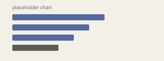

- Fannie Mae took **54%** of GSE-sold loans in the top 15 states.
- New York leans on Fannie Mae the most, at **57%**.
- Ohio is nearly an even split, with **51%** going to Fannie Mae.
- The top 3 states match total sales, so the choice of GSE isn't driven by geography.
